# Kiln brand

## Logo
| File | Use |
|---|---|
| `logo/mark.svg` | the mark |
| `logo/mark-mono.svg` | one colour (`currentColor`) |
| `logo/lockup-dark.svg`, `logo/lockup-light.svg` | mark + wordmark, on dark / light |
| `logo/app-icon.svg`, `logo/png/`, `logo/kiln.ico` | app icon |
| `logo/favicon.svg` | favicon |
| `community/discord-banner.png` (1600×500), `-1200x630.png`, `-960x540.png` | Discord invite banner: README, Nexus and social posts. The `.svg` files are the sources (fonts embedded); render with `rsvg-convert`. The Discord symbol is Discord's own ([discord.com/branding](https://discord.com/branding)), unaltered |

Clear space: ¼ of the mark's height. Minimum: mark 16 px, lockup 96 px wide. No recolouring, stretching or effects.

## Colour
| | |
|---|---|
| Soot | `#080504` `#110c09` `#1a120e` `#251a14`, well `#0a0705` |
| Text | `#f5e9db` `#dccbba` `#ab9682` |
| Ember | `#ff6a1a` (primary) `#ff8f45` `#e5530a` `#b83f05` |
| Gold | `#f9c74f` |
| State | `#8fd6b4` `#8cbbe3` `#f9c74f` `#ff7d66` |

Text on ember or gold is `#170803`. Full set: `palette.json`.

## Type
Grenze Gotisch (names), Alegreya Sans and Alegreya Sans SC (UI, labels), Inconsolata (data). All OFL.

## Voice
Plain, specific, calm.

---
Enshrouded is a trademark of Keen Games GmbH. Kiln is unofficial.
